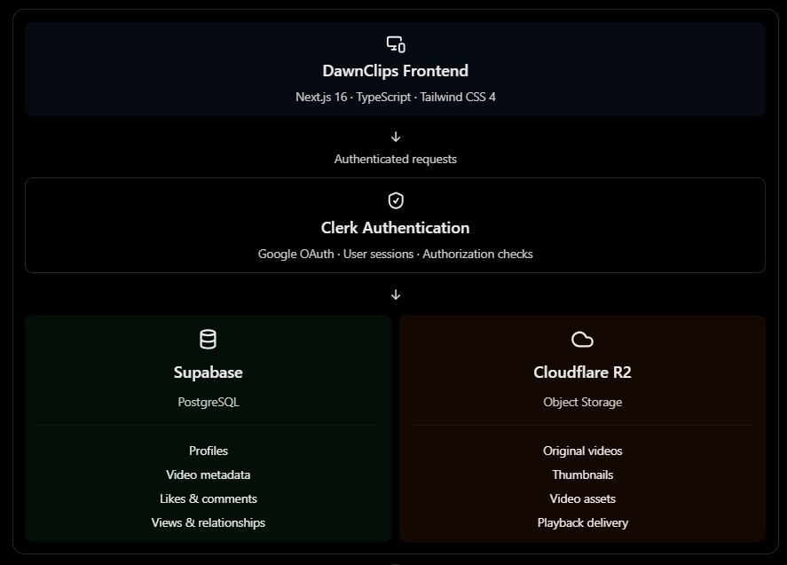
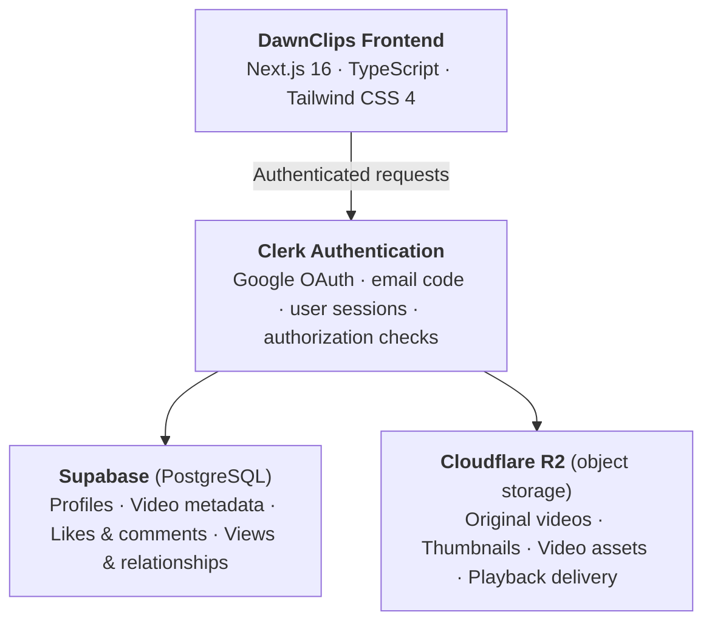
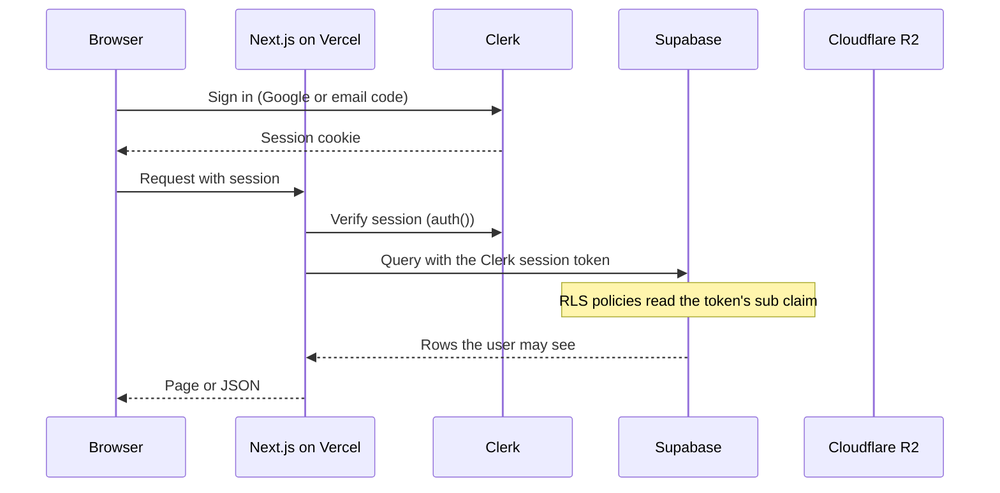

# DawnClips architecture

DawnClips is a Next.js application deployed on Vercel. Clerk handles sign-in, Supabase stores the data, and Cloudflare R2 stores the video files.

## Overview

The same diagram as text, so it stays reviewable in diffs:

| Layer | Technology | Responsibility |
| --- | --- | --- |
| Frontend | Next.js 16 (App Router, Cache Components), TypeScript, Tailwind CSS 4 | Pages, feeds, the clip viewer, uploads, settings, the landing page and legal pages. Hosted on Vercel. |
| Authentication | Clerk | Google sign-in and passwordless email code, sessions, and the identity (`sub`) every server check relies on. |
| Database | Supabase (PostgreSQL with Row Level Security) | Profiles, clip metadata, likes, comments, bookmarks, follows, blocks, notifications, reports, views and watch events. |
| Object storage | Cloudflare R2 | Original MP4 videos and cover images, delivered through public URLs or short-lived signed URLs. |

## What lives where

| Supabase (PostgreSQL) | Cloudflare R2 |
| --- | --- |
| Profiles and profile settings | Original videos (`clips/<profile id>/<clip id>.mp4`) |
| Video metadata: title, description, hero tags, visibility, duration, object keys | Thumbnails and cover images (`.jpg`, same key pattern) |
| Likes, comments and bookmarks | Video assets for playback (private and unlisted clips use short-lived signed URLs) |
| Views, watch events, follows, blocks, notifications, reports | Nothing else. R2 holds files only, never user records. |

## How a request actually flows

The diagram shows Clerk between the frontend and the two data stores. In the implementation Clerk does not sit in the data path. It issues the session, and each backend verifies what the session proves:

- **Identity.** The Clerk `sub` is the only trusted identity. The server never accepts a user id from the client.
- **Database access.** Server code calls Supabase with the user's Clerk token. Supabase trusts Clerk through Third-Party Auth, and Row Level Security policies read `auth.jwt()->>'sub'`. Privileged work (deleting a clip, moderation, account deletion, playback authorization) uses the service-role key on the server only.
- **Uploads.** The server checks the request, then hands the browser a short-lived upload URL. The video goes from the browser straight to R2. On completion the server verifies the object's size, content type and MP4 signature before the clip is published.
- **Playback.** Public published clips can use the optional public R2 origin. Private and unlisted clips go through `authorize_clip_playback` and a short-lived signed URL that is never stored.
- **Deleting.** Deleting a clip removes its R2 objects first, then the database row. Account deletion removes R2 objects before database rows and does not report success if storage cleanup fails.
- **Webhook.** Clerk calls `/api/webhooks/clerk` for `user.created`, `user.updated` and `user.deleted`. The app also creates a profile on the first authenticated request, so sign-in never waits for the webhook.

## Production setup notes

- **Clerk on a `*.vercel.app` domain.** The production Clerk instance serves its Frontend API through the app at `/__clerk`, so the token issuer is `https://<your-domain>/__clerk`. The middleware matcher in `proxy.ts` must include `/__clerk/(.*)`.
- **Supabase Third-Party Auth.** Supabase's Clerk provider only accepts `https://clerk.<domain>` or `*.clerk.accounts.dev`, so it rejects that issuer. Add it with **Custom OIDC** instead, using `https://<your-domain>/__clerk` as the issuer URL. Keep the Clerk Supabase integration activated on the instance so tokens carry `role: "authenticated"`.
- **Do not use a JWT template.** The app uses the default session token (`getToken()` with no template name).
- **Diagnosing `PGRST301`.** `No suitable key or wrong key type` in the logs means Supabase could not verify the Clerk token. Check that the token's `iss` exactly matches an issuer listed under Third-Party Auth. In the browser console: `(({iss,role})=>({iss,role}))(JSON.parse(atob((await Clerk.session.getToken()).split('.')[1].replace(/-/g,'+').replace(/_/g,'/'))))`.
- **Multiple Clerk instances.** Development and production tokens have different issuers. If both are listed in Supabase, both can reach the same data. Remove the development entry when it is not needed.

## Known behavior

- Vercel logs can show `Expected the resume to render <ReactClerkProvider> in this slot but instead it rendered <ClerkProvider>`. React falls back to client rendering for that request and the app works. It comes from the async Clerk provider combined with Cache Components and partial prefetching, and Suspense, the `dynamic` prop and moving the provider were tried without effect.
- Next.js aborts uncached fetches when a prerender finishes. `lib/db-log.ts` skips logging those aborts so real database errors stay visible.
